# React Udemy Course Notes <!-- omit in toc -->

## Table of contents <!-- omit in toc -->

* [1. Setuping react project](#1-setuping-react-project)
* [2. JavaScript refresher](#2-javascript-refresher)
* [3. React Essentials](#3-react-essentials)
  * [3.1. Components](#31-components)
  * [3.2. index.jsx](#32-indexjsx)
  * [3.3. Built-in vs custom components](#33-built-in-vs-custom-components)
  * [3.4. Dynamic values inside JSX](#34-dynamic-values-inside-jsx)
  * [3.5. Loading images](#35-loading-images)
  * [3.6. Props](#36-props)
  * [3.7. Project Structure](#37-project-structure)
  * [3.8. Component composition - special `children` prop](#38-component-composition---special-children-prop)
  * [3.9. Reacting to events](#39-reacting-to-events)
    * [3.9.1. `onClick` prop](#391-onclick-prop)
  * [3.10. State](#310-state)
  * [3.11. Rendering output conditionally](#311-rendering-output-conditionally)
    * [3.11.1. Using the ternary operator](#3111-using-the-ternary-operator)
    * [3.11.2. Using logical AND (`&&`)](#3112-using-logical-and-)
    * [3.11.3. Using variables](#3113-using-variables)
  * [3.12. CSS styling and dynamic styling](#312-css-styling-and-dynamic-styling)
  * [3.13. Outputting list data automatically](#313-outputting-list-data-automatically)
* [4. React Essentials - Deep Dive](#4-react-essentials---deep-dive)
  * [4.1. You don't have to use JSX](#41-you-dont-have-to-use-jsx)
  * [4.2. Working with Fragments](#42-working-with-fragments)
  * [4.3. When should you split components?](#43-when-should-you-split-components)
  * [4.4. Props are not forwarded automatically](#44-props-are-not-forwarded-automatically)
  * [4.5. Multiple JSX slots](#45-multiple-jsx-slots)
  * [4.6. Setting component types dynamically](#46-setting-component-types-dynamically)
  * [4.7. Setting default prop values](#47-setting-default-prop-values)
  * [4.8. Not all content must go into components](#48-not-all-content-must-go-into-components)
  * [4.9. Public folder](#49-public-folder)
  * [4.10. When to create a component](#410-when-to-create-a-component)
  * [4.11. Updating state based on previous state](#411-updating-state-based-on-previous-state)
    * [4.11.1. Why do you pass a function?](#4111-why-do-you-pass-a-function)
  * [4.12. Update object-state immutably](#412-update-object-state-immutably)
  * [4.13. Lifting the state up](#413-lifting-the-state-up)
    * [4.13.1. Lifting computed values up](#4131-lifting-computed-values-up)
  * [4.14. Avoid intersecting states](#414-avoid-intersecting-states)
  * [4.15. Deriving state](#415-deriving-state)
* [5. Styling React Components](#5-styling-react-components)
  * [5.1. Splitting CSS code across multiple files](#51-splitting-css-code-across-multiple-files)
  * [5.2. Vanilla CSS](#52-vanilla-css)
    * [5.2.1. Pros](#521-pros)
    * [5.2.2. Cons](#522-cons)
  * [5.3. CSS modules](#53-css-modules)
    * [5.3.1. Pros](#531-pros)
    * [5.3.2. Cons](#532-cons)
  * [5.4. styled-components third party package](#54-styled-components-third-party-package)
    * [5.4.1. Pros](#541-pros)
    * [5.4.2. Cons](#542-cons)
  * [5.5. Tailwind CSS](#55-tailwind-css)
    * [5.5.1. Adding custom font](#551-adding-custom-font)
    * [5.5.2. Media queries and pseudo selectors](#552-media-queries-and-pseudo-selectors)
    * [5.5.3. Pros](#553-pros)
    * [5.5.4. Cons](#554-cons)
* [6. Debugging React apps](#6-debugging-react-apps)
  * [6.1. React strict mode](#61-react-strict-mode)
* [7. Refs and portals](#7-refs-and-portals)
  * [7.1. Refs](#71-refs)
* [8. React behind the scenes - optimization techniques](#8-react-behind-the-scenes---optimization-techniques)
  * [8.1. How does React update the DOM?](#81-how-does-react-update-the-dom)
  * [8.2. Optimization](#82-optimization)
    * [8.2.1. `React.memo()`](#821-reactmemo)
    * [8.2.2. Avoid component function executions with clever structuring](#822-avoid-component-function-executions-with-clever-structuring)
    * [8.2.3. `useCallback()` hook](#823-usecallback-hook)
    * [8.2.4. `React.useMemo()`](#824-reactusememo)

# 1. Setuping react project

1. Special project setup is needed for react app as we'll be using html in javascript (jsx) 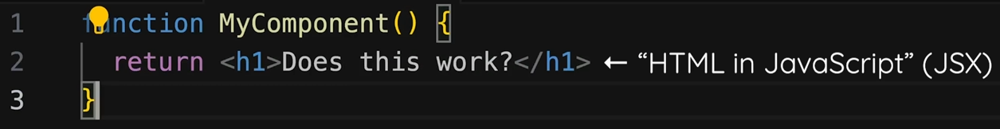 and it does not work in the browser 
2. One option without installing anything is to use webapp by typing `react.new` in browser
3. for local in IDE Vite (pronounced "wit") or create-react-app is needed
4. those tools use node.js so you need to install it
5. steps for creating project in Vite:
   1. type `npm create vite@latest <project_name>`
   2. select a framework - React
   3. select a variant - TypeScript
   4. `npm install`
   5. `npm run dev` - starts a development preview server that allows you to view the web app you're working on (quit it anytime using ctrl+c)

# 2. JavaScript refresher

Normal html with js projects need script tags in html file. In React you will not link them manually as **React projects use a build process**. This means that the code you write is not the code that gets executed (like this) in the browser.
It's React-scripts package (can be seen in package.json) that takes your code and transform it behind the scenes. It one of things is injecting sript tags to html file.
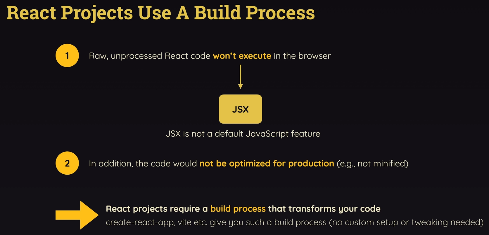

In React during import statements you omit extension of a file (as opposed in raw js where typically '.js' should be added to file name).

To use import and export in js file you would need to add attribute 'type="module"' to script tag in html file, but react's auto-injected script tags do not have them. That's because build process will merge those seperate files you have during development into one big file (or a bunch of big files) imported with old-school syntax in the right order. This is made to make this code execute in browsers that do not support this import-export syntax.

# 3. React Essentials

## 3.1. Components

Reusable building blocks.

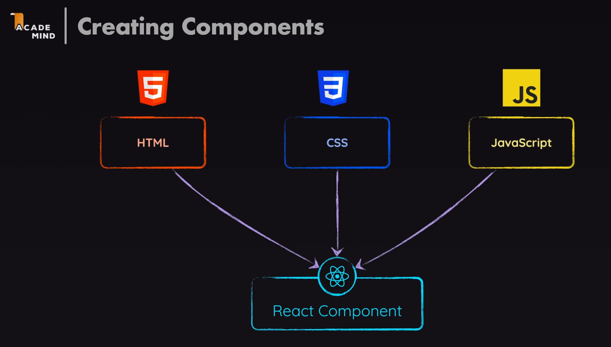
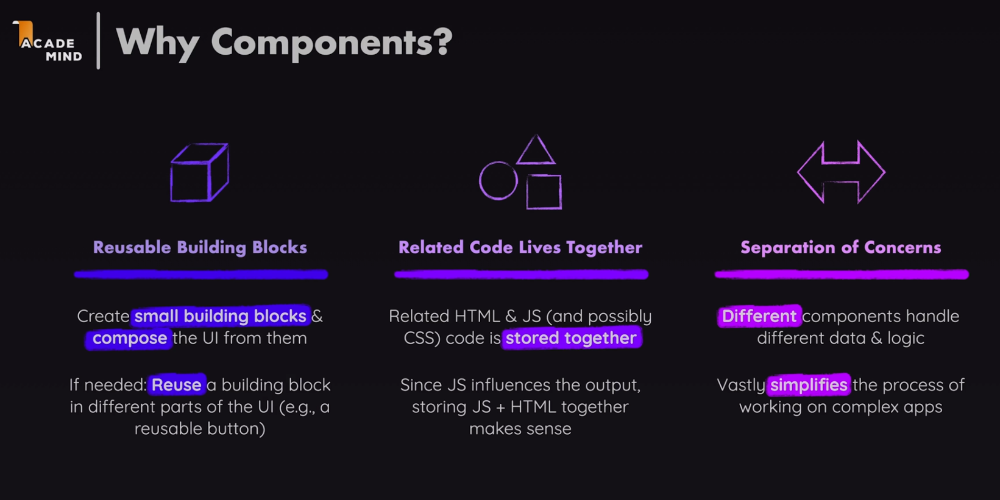


Component is a really just a JavaScript function. But to be recognised as a component by a React it must follow two rules:

1. Name starts with uppercase character
2. It returns a "Renderable" content

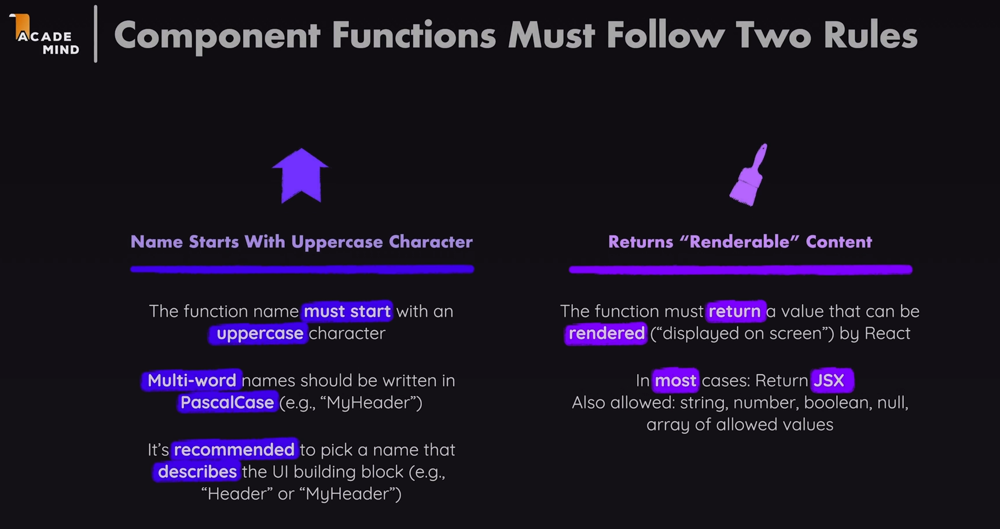

In JS u would use a function `function Header() {}` by executing it `Header()` but that's not how you use components in React. You can use your function as regular HTML element inside JSX code `<Header></Header>`. You could also use self-closing syntax `<Header />`.

## 3.2. index.jsx

_index.jsx_ file acts as a main entry point of React App since it is the first file to be loaded by the HTML file. ReactDOM library (which we import in this file) renders this app component. It is responsible of putting App component contents on the screen. It is rendered by passing jsx code to the `render` method. This `render` method is called on a object that's created by another method (`createRoot` method). `createRoot` method takes existing HTML element as an input (so an element that's not being created by a React, but rather is in _index.html_ file already). So `render` method takes component and renders it inside HTML element.
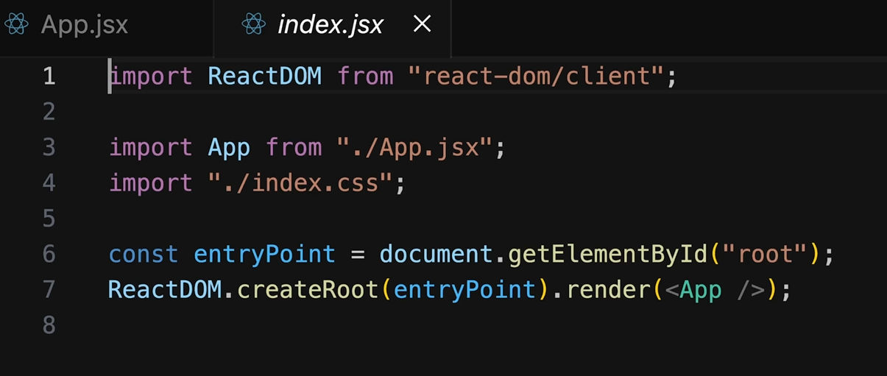
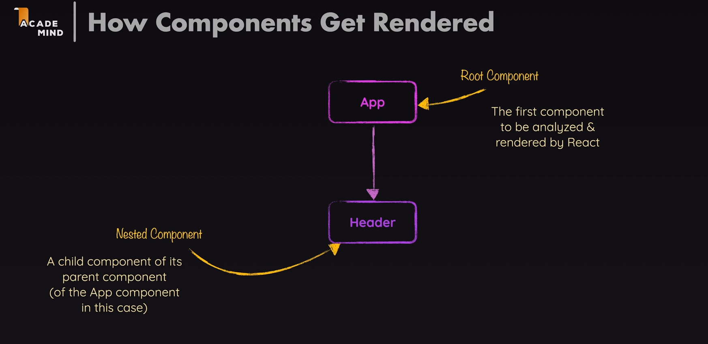
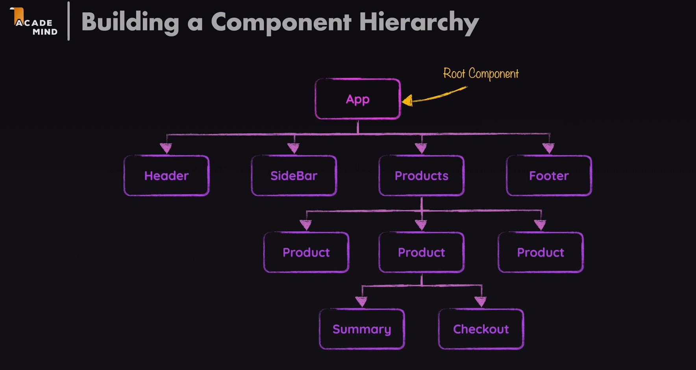

## 3.3. Built-in vs custom components

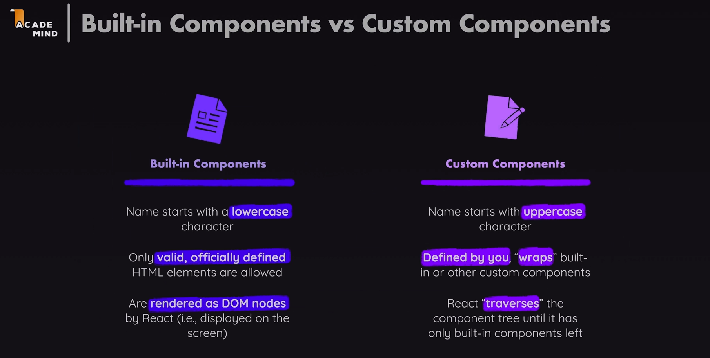

## 3.4. Dynamic values inside JSX

To place a dynamic value in JSX you need to use curly braces `{}`.

## 3.5. Loading images

You shouldnt use standard ``.

Instead you should use import with relative path to this file `import reactImg from './assets/image-name.png'` and then inside JSX ``.

## 3.6. Props

React allows you to pass data to components. via a concept called **props**.
The parameters in function signature of components are what in React is called props. They are called with the value taken from JSX tag attributes, fe:

```html
<CoreConcept
  title="Components"
  description="The core UI building block."
  image="{componentsImg}"
/>
```

```JSX
function CoreConcept(props) {
  return (
    <li>
      
        <h3>props.title</h3>
        <p>props.description</p>
      </img>
    </li>
  );
}
```

## 3.7. Project Structure

Best practice is to store one component per file. Those files are usually stored in a _components_ subfolder of _src_ folder. The convention is to name those files the same name as the component name that will be stored in that file. Most of the time exporting is done using `default` keyword.

Css files related to components should have the same name as the component file and put in the same folder. They are then imported in a related component file.

Be careful as those styles in css file are **NOT** scoped only to this component. Splitting the css code into the component specific css files can still make sense since it makes it easy to see which style SHOULD relate to which component, making adjusting those styles easier.
(There is a solotion to this potential problem. Later in course.)

There is an option to create a folder for each group of files related to component, named the same as component file. This is not required and comes down to personal preference.

## 3.8. Component composition - special `children` prop

React by default ignores input between opening and closing component tags. To use something like `<TabButton>Components</TabButton>` you need to add parameter (usually called props) to a component function signature as usual. There is a special built-in children prop (`props.children`). This children prop simply refers to the content between component tags.

## 3.9. Reacting to events

In vanilla JS to react to event for a button click you would do something like this `document.querySelector('button').addEventListener('click', () => {})`.

In a React project we don't want to write imperative code like this, instead we want to write declarative code. You can do that by adding special attribute (special prop) to elements.

There are many special props which name starts with `on`. Their value is always a funcion.

The function name convention for special prop is to use _handle_ + _name of the event_ (e.g.: `handleClick`). Another common option is to call it _name of the event_ + _Handler_ (e.g.: `clickHandler`)

### 3.9.1. `onClick` prop

```jsx
export default function TabButton({ children }) {
  function handleClick() {
    console.log("Hello World!");
  }

  return (
    <li>
      <button onClick={handleClick}>{children}</button>
    </li>
  );
}
```

## 3.10. State

By default React component funtions execute only once. So if there is a change in displayed content there is a way to tell react to execute component function again.

State is all about registering variables that are handled by React and are updated with the help of a function that's provided by React, that will also tell React that data changed, that will therefore cause React to update the UI.

Those special variables are created with the help of the special function that must be imported from React library.

```jsx
import { useState } from "react";
```

This are so called React hook. All these funtions that start with 'use' in React projectsare React hooks. Special thing about React hooks is that they are technically regular functions, but they must ONLY be called inside of React component functions, or inside of other React hooks (e.g. custom React hooks).

You must call those hook functions directly inside of the component functions, not nested inside some other code (e.g. not nested inside of inner function of component function). It must be called on the top level of component function.

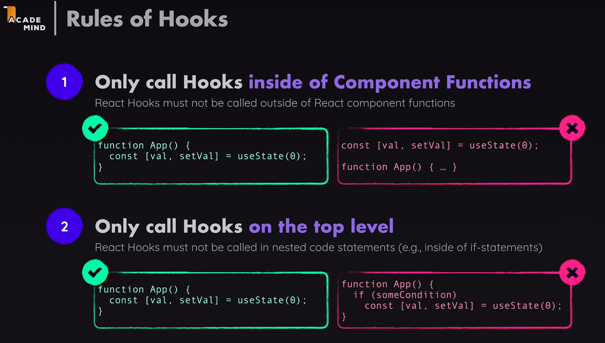

`useState` is one of the most important hooks offered by React, because that's the hook that will allow us to manage component specific state, which is simply some data stored by React, which when changed will trigger this component function, to which this hook belongs, to re-execute.

`useState` accept an argument which is default value React will store and use the first time component is rendered. `useState` also returns a value which can be stored in variable or constant (it doesnt matter). This value is an array which has exactly 2 elements. Commonly it is received using array destructuring to store these 2 elements in 2 seperate constants. Common naming convention is to use something like:

```jsx
const [selectedTopic, setSelectedTopic] = useState("Please click a button");
```

First element in returned array from setState is the current data snapshot for this component execution cycle. So for first execution of component function it will be this initial value. If it's executed again for some reason it will be the updated value.

The second element will always be a function. A function provided by React that can be executed to update this state (this stored value). ut in addition to updating this stored value, calling this special function will also tell React that component function must be executed again.

We can use const here because value stored as state will be recreated everytime this component function executes. But behind the scenes React will update the actual value that will be passed on to this constant when this component function executes again.

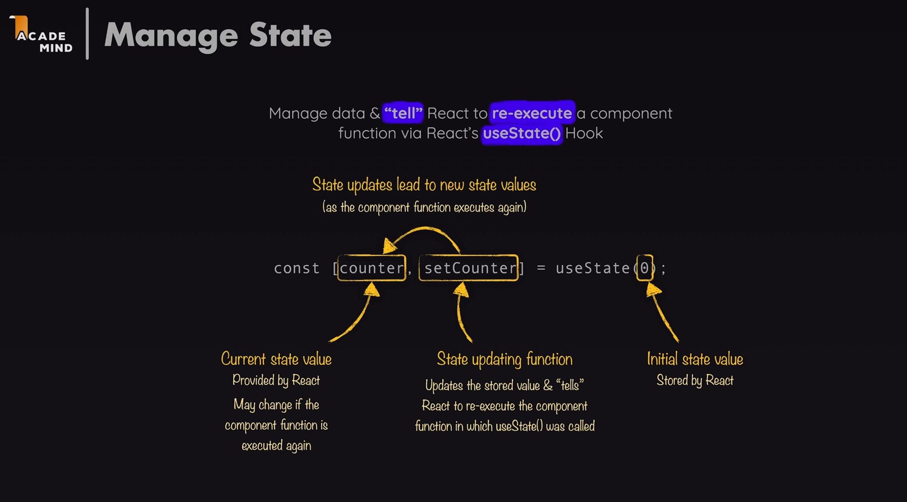

**Two rules of hooks**:

- only call hooks at the top level
- only call hooks from react funtions (component functions or custom hooks)

**Derived state**:

- If you can calculate something from existing data during render, you should NOT put it in state.

## 3.11. Rendering output conditionally

### 3.11.1. Using the ternary operator

You can putt null in JSX code then nothing will be rendered. Useful in ternary operators inside JSX code.

```jsx
{
  !selectedTopic ? <p>Please select a topic.</p> : null;
}
```

### 3.11.2. Using logical AND (`&&`)

or using `&&`

```jsx
{
  !selectedTopic && <p>Please select a topic.</p>;
}
```

### 3.11.3. Using variables

or store it in variable

```jsx
// inside component function
let tabContent = <p>Please select a topic.</p>;

if (selectedTopic) {
  tabContent = (
    <div id="tab-content">
      <h3>{EXAMPLES[selectedTopic].title}</h3>
      <p>{EXAMPLES[selectedTopic].description}</p>
      <pre>
        <code>{EXAMPLES[selectedTopic].code}</code>
      </pre>
    </div>
  );
}

return { tabContent };
```

## 3.12. CSS styling and dynamic styling

In standard html to change declare class you would use `class` prop. But there is React specific built-in prop `className`. Most of other attributes like `id` and so on are the same in JSX and HTML. Just for this class attribute it's different.

## 3.13. Outputting list data automatically

As React can output array of JSX elements but not array of js objects, we need to transform them to JSX elements. We can achieve that by using `Arrays.map()` method.

```jsx
// inside renderable content
{
  CORE_CONCEPTS.map((conceptItem) => (
    <CoreConcept {...conceptItem} key={conceptItem.title} />
  ));
}
```

When dynamically outputting a list of elements, every element should receive a unique "key" to help React tell the list items apart.

# 4. React Essentials - Deep Dive

## 4.1. You don't have to use JSX

As a React developer you should know that in theory you could build React apps without using JSX and therefore without need of special build process. Vast majority of React projects use JSX though.

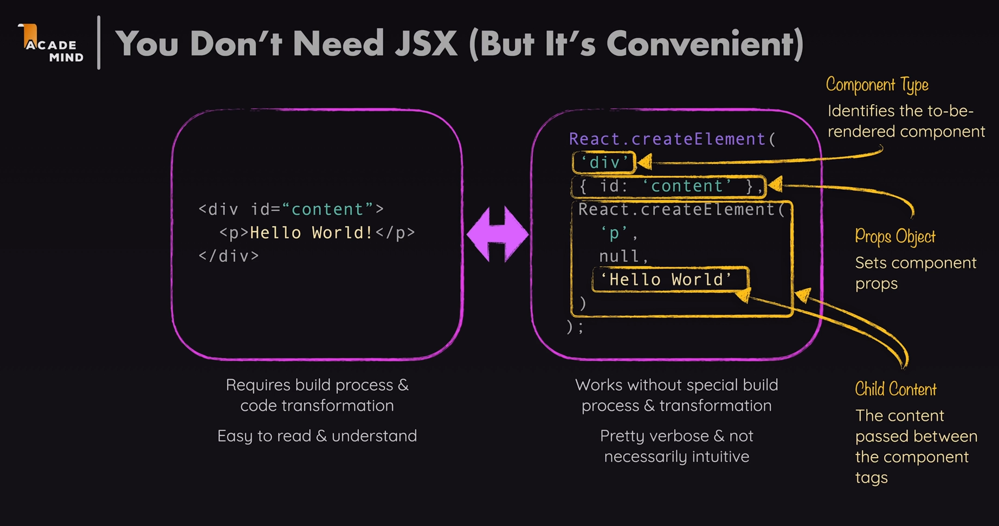

## 4.2. Working with Fragments

JSX expressions must have one parent element. That's because in the end JSX is syntactic sugar over `React.createElement` function which expects one argument. That's why there's often a need to wrap sibling elements in opening and closig div tags. This limitation means that you do end up with empty div in your DOM structure.

That's why there's an alternative. There is a wrapper if u do need a root component to wrap some sibling components, but you dont want to render an actual element to the screen. For this you can import Fragment component like this:

```jsx
import { Fragment } from "react";
```

and use it instead of div as a wrapper for renderable content.

Modern React projects use even shorter alternative. There you don't even need to import Fragment. You just use empty tags as a wrapper, so end code would look like this:

```jsx
return {
  <>
    <Header />
    <main>
    </main>
  </>
}
```

## 4.3. When should you split components?

Put different features into different components.
If you managing the state of the inner component, then you probabli want to split up.

## 4.4. Props are not forwarded automatically

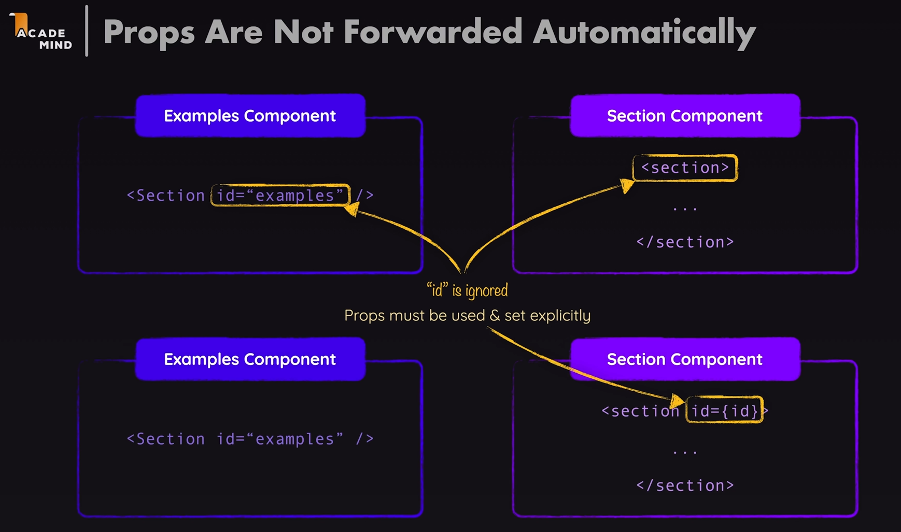

To solve this problem we could in component function accept all of the needed attributes and forward them manually. That can cause a lot of manual work and isn't really scalable.

We can use a pattern called **Forwarded Props** or **Proxy Props**.

It is used using standard JS **rest property** (`...`) at the end of component function parameters declaration. This syntax group all remaining object properties into a new object. It is usually named _props_.

It is a usefull pattern when building wrapper components.

## 4.5. Multiple JSX slots

As we know we can use special `children` prop to access JSX within opening and closing tag of our component. But it isn't the only place where JSX code is accepted. Actually any prop can take JSX code so we can use it in dumb component to enforce some kind of structure without being overly specific:

```jsx
export default function Tabs({ children, buttons }) {
  return (
    <>
      <menu>{buttons}</menu>
      {children}
    </>
  );
}
```

## 4.6. Setting component types dynamically

You can make a prop that will represent the type of inner component in your returned renderable content. This prop takes component identifier. Custom components must be passed as a dynamic value (enclosed with `{}`, e.g.: `{Section}`) and built-in components must be passed as a string (enclosed with `""`, e.g.: `"menu"`).

Component with dynamic inner component types would look like this:

```jsx
export default function Tabs({ children, buttons, buttonsContainer }) {
  const ButtonsContainer = buttonsContainer;
  return (
    <>
      <ButtonsContainer>{buttons}</ButtonsContainer>
      {children}
    </>
  );
}
```

Important thing there is that we can't use `buttonsContainer` prop directly as a tag name as it starts with lowercase letter, and that would mean in JSX to look for a built-in componenent `buttonsContainer` which doesnt't exists. Thus we create const with name starting with uppercase letter and use it in a tag instead. We could of course take a shortcut and just name this prop with leading uppercase character.

Then we would use it like this with custom component:

```jsx
<Tabs buttonsContainer={Section}></Tabs>
```

or like that with built-in component:

```jsx
<Tabs buttonsContainer="menu"></Tabs>
```

## 4.7. Setting default prop values

Just like in JS.

ButtonsContainer example:

```jsx
export default function Tabs({ children, buttons, ButtonsContainer = "menu" }) {
  return (
    <>
      <ButtonsContainer>{buttons}</ButtonsContainer>
      {children}
    </>
  );
}
```

## 4.8. Not all content must go into components

While working in React it is easy to forget that content that displays static data (e.g.: header with a picture) that does not rely on props does not have to be a component. We can just use standard html in index.html.

## 4.9. Public folder

The public/ Folder
As shown in the previous lecture you can store images in the public/ folder and then directly reference them from inside your index.html or index.css files.

The reason for that is that images (or, in general: files) stored in public/ are made publicly available by the underlying project development server & build process. Just like index.html, those files can directly be visited from inside the browser and can therefore also be requested by other files.

If you try loading localhost:5173/some-image.jpg, you'll be able to see that image (if it exists in the public/ folder, of course).

The src/assets/ Folder
You can also store images in the src/assets/ folder (or, actually, anywhere in the src folder).

So what's the difference compared to public/?

Any files (of any format) stored in src (or subfolders like src/assets/) are not made available to the public. They can't be accessed by website visitors. If you try loading localhost:5173/src/assets/some-image.jpg, you'll get an error.

Instead, files stored in src/ (and subfolders) can be used in your code files. Images imported into code files are then picked up by the underlying build process, potentially optimized, and kind of "injected" into the public/ folder right before serving the website. Links to those images are automatically generated and used in the places where you referenced the imported images.

Which Folder Should You Use?
You should use the public/ folder for any images that should not be handled by the build process and that should be generally available. Good candidates are images used directly in the index.html file or favicons.

On the other hand, images that are used inside of components should typically be stored in the src/ folder (e.g., in src/assets/).

## 4.10. When to create a component

when you need to repeat yourself codewise.

## 4.11. Updating state based on previous state

You should **NOT** update state based on the previous value of that state like this:

```jsx
function handleEditClick() {
  setIsEditing(!isEditing);
}
```

Instead, you should pass a function to that state-updating function:

```jsx
function handleEditClick() {
  setIsEditing((editing) => !editing);
}
```

This is a strong recommendation by the React team and best practise in real world. It is something you should simply memorize.

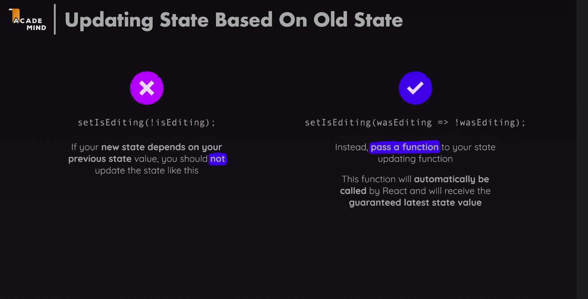

### 4.11.1. Why do you pass a function?

Because this function you pass will be called by React and it will automatcally get the current state value as an input.

The correct approach might look overly complex and seem to behave the same.

To understand this it is important to know that React behind the scenes in the end is scheduling those state updates you are triggering with those state updating functions, like `setIsEditing`. So this state update is **not performed instantly**, instead it is scheduled by React to be performed in the future. Now, the future will probably be in 1 or 2ms, but it's not instant.

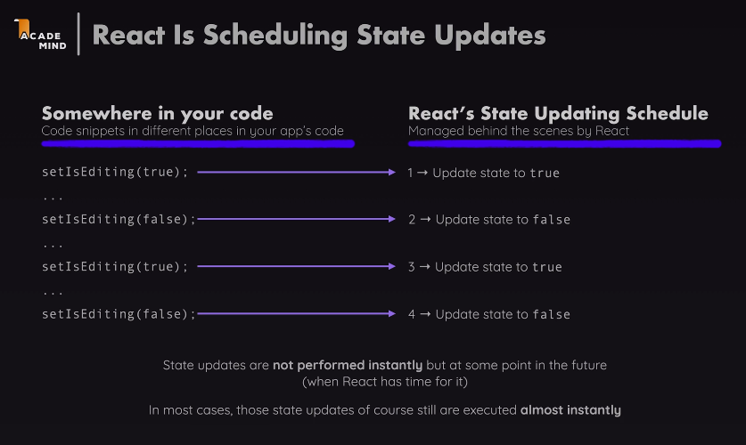

Take this code snippet as an example:

```jsx
function handleEditClick() {
  setIsEditing(!isEditing);
  setIsEditing(!isEditing);
}
```

If you don't know about how React works you might not get the result you might expect. Because you might expect that the first `setIsEditing` call is setting `isEditing` to the opposite of it currently is, and since it is `false` by default this should set it to `true`. And since we do the same in the next line we might expect to set it back to false. So you might expect that nothing happens.

But thats not what's happening - we set the value twice to true.

That's why we should pass an updater function to `setIsEditing` instead of a value. React passes the current state as an argument to the updater function, allowing us to calculate the next state from the latest value.

So this snippet will give us the expected result:

```jsx
function handleEditClick() {
  // editing => false
  setIsEditing((editing) => !isEditing);
  // editing => true
  setIsEditing((editing) => !isEditing);
  // editing => false
}
```

## 4.12. Update object-state immutably

If your state is an object or array you update that state in immutable way. That means you simply create a copy of the old state and then change that copy instead of existing object or array.

The reason is that if your state is an object or array you're dealing with a reference value in JS, and therefore if you would be updating it like this:

```jsx
// wrong way of updating state that is an object or array
function handleSelectSquare(rowIndex, colIndex) {
  setGameBoard((prevGameBoard) => {
    prevGameBoard[rowIndex][colIndex] = "X";
    return prevGameBoard;
  });
}
```

you would be updating the old value in memory immediately, even before this scheduled state update was executed by React. This can lead to strange bugs and side effects if you have multiple places in your application that are scheduling state updates for the same state.

```jsx
// correct way of updating state that is an object or array
function handleSelectSquare(rowIndex, colIndex) {
  setGameBoard((prevGameBoard) => {
    const updatedBoard = [
      ...prevGameBoard.map((innerArray) => [...innerArray]),
    ];
    updatedBoard[rowIndex][colIndex] = "X";
    return updatedBoard;
  });
}
```

Here's another example:

```jsx
// wrong way of updating state that is an object or array
function App() {
  const [gameTurns, setGameTurns] = useState([]);
  const activePlayer = deriveActivePlayer(gameTurns);

  let gameBoard = initialGameBoard;
  for (const turn of gameTurns) {
    const { square, player } = turn;
    const { row, col } = square;

    gameBoard[row][col] = player;
  }
  //...
}
```

As arrays are references, changing `gameBoard` would also change `initialGameBoard`. Considering that if we would restart the game we would like to go back to `initialGameBoard` that is unintended behavior and often a hard bug to notice.

So better to keep it immutable and deep copy an array:

```jsx
// correct way of updating state that is an object or array
function App() {
  const [gameTurns, setGameTurns] = useState([]);
  const activePlayer = deriveActivePlayer(gameTurns);

  let gameBoard = [...initialGameBoard.map((col) => [...col])];
  for (const turn of gameTurns) {
    const { square, player } = turn;
    const { row, col } = square;

    gameBoard[row][col] = player;
  }
  //...
}
```

## 4.13. Lifting the state up

If multiple components need the same information, we need to manage the state in the closest ancestor component, that has access to both components that need that information. Ancestor component will give that information tomcomponents via props.

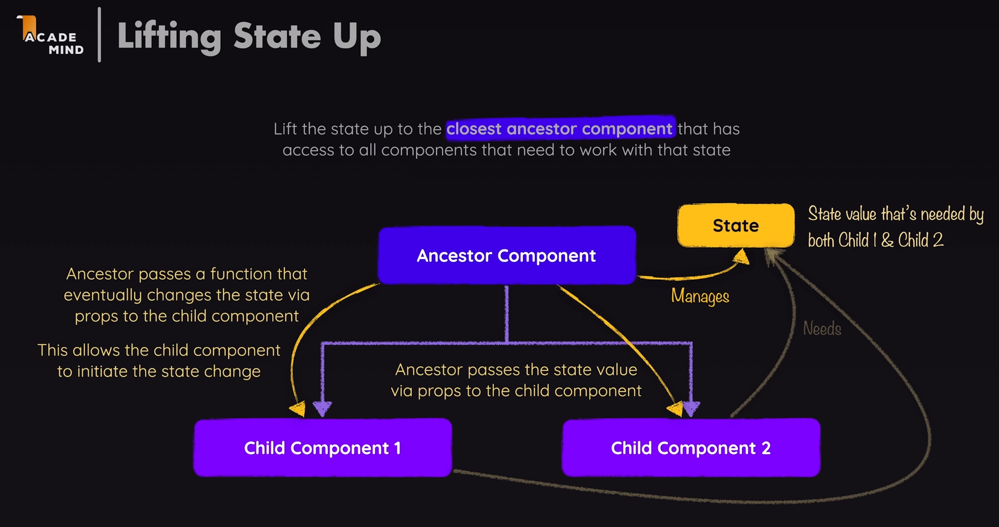

### 4.13.1. Lifting computed values up

If derived state is needed in parent component it is also common to move code that computes this state up.

## 4.14. Avoid intersecting states

Don't add a state that's managing the same or very similar information like the state you already have in different component. You can for example lift the state up with some changes to avoid that.

## 4.15. Deriving state

It means to instead of managing another state in component, we rather take state from parent component and compute it to achieve desired structure of data.

in React you should manage as little state as needed and try to derive as much information and as many values as possible from that state.

# 5. Styling React Components

## 5.1. Splitting CSS code across multiple files

One option definetely is to simply add a css file to your project (like index.css), define all your css rules in there using element/id/class selectors. Then import this css file. And in a typical React project, fe. using vite as underlying development and build tool, you can import css files into js files and build tool identify such imports and in the end will make sure that css file that is imported will be injected into webpage (in devtools in elements this file can be seen as style type="text/css"). There can be as many vanilla css files as you want. So you could for example split this one css file into component related css files (in devtools in elements now there will be element for each injected css file).

## 5.2. Vanilla CSS

### 5.2.1. Pros

- **Decoupling** - CSS code is separate from JSX code
- **Familiarity** - you write CSS as you (maybe) know and (maybe) love it
- **Low-access collaboration** - CSS can be written by another developer who needs only minimal access to your JSX code

### 5.2.2. Cons

- **No scoping** - CSS rules are not scoped to components and may clash across components (e.g. the same class name used in different components for different purposes)
- **CSS knowledge required** - you need to know CSS

## 5.3. CSS modules

Allows to write vanilla CSS rules with file scoping.

It's not a default browser or JS feature. It is an approach where build tools will transform your CSS class names, and only those, to class names that are guaranteed to be unique per file.

To use this you need proper build tool like vite.
Then to create scoped css file it must be named like this:

```
Header.module.css
```

This `<file-name>.module.css` name convention is a signal to build tool to process this file slighty different.

Importing it to jsx fila also looks different. Rather than this:

```jsx
import "./Header.css"; // vanilla css import
```

it should look now like this:

```jsx
import classes from "./Header.module.css"; // module css import
```

Now we have to import something from this module file, and that something is JS object that will be created by underlying build process. It can be named 'styles' or 'classes' or whatever you want. But 'classes' is a fitting name because this object will contain your class names transformed to unique class names. Then u can use this class to access its properties to style components like this:

```tsx
import logo from "../assets/logo.png";
import classes from "./Header.module.css";

export default function Header() {
  return (
    // 'paragraph' is css class name that you can access through classes object
    <header>
      
      <h1>ReactArt</h1>
      <p className={classes.paragraph}>
        A community of artists and art-lovers.
      </p>
    </header>
  );
}
```

In devtools you can see that the final class name will be different:
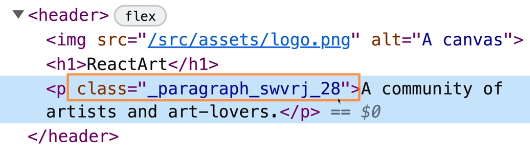

### 5.3.1. Pros

> [!NOTE]
> **Decoupling**, **Familiarity**, and **Low-access collaboration** are the same as Vanilla CSS.

- **Decoupling** - CSS code is separate from JSX code
- **Familiarity** - you write CSS as you (maybe) know and (maybe) love it
- **Low-access collaboration** - CSS can be written by another developer who needs only minimal access to your JSX code
- **Scoping** - CSS classes are scoped to the component (files) which import them, so there are no CSS class name clashes

### 5.3.2. Cons

> [!NOTE]
> **CSS knowledge required** is the same as Vanilla CSS.

- **CSS knowledge required** - you need to know CSS
- **File sprawl** - you may end up with many relatively small CSS files in your project

## 5.4. styled-components third party package

install:

```bash
npm install styled-components
```

use:

```jsx
import { styled } from "styled-components";
```

`styled` is JS object that consists properties of html elements

You can style in component using special syntax. It looks like this:

```jsx
styled.div``;
```

Notice two backticks at the end. This syntax is **tagged template** which is a regular JS feature (even though you may never heard about it).

In the end tagged template is like a function which receives template literal as an input. In our case this template literal should receive all the styles you want to apply to this div. Reminder that template literals can be multiline.

```jsx
styled.div`
  display: flex;
  flex-direction: column;
  gap: 0.5rem;
  margin-bottom: 1.5rem;
`;
```

We can store this in const or variable and use it as html tag:

```jsx
const ControlContainer = styled.div`
    display: flex;
    flex-direction: column;
    gap: 0.5rem;
    margin-bottom: 1.5rem;
`;
...
<ControlContainer><ControlContainer/>
```

Under the hood this library just creates classes for html elements.

The elements you create using styled-components also forward all of the props to the built-in html component. So you can use inline styled with styled-components to, for example, conditinally assign a class to an element.

```jsx
<Label className={`label ${emailNotValid ? 'invalid' : ''}`}>
```

Even though you can do that (mix vanilla/inline CSS with styled-components) you would typically go for one solution to use for everything. So typically we don't want to add CSS classes like this.

Instead we can do it using styled-components by adding a special prop e.g. `invalid` and then use it in styled component.

This can be achieved by using dynamic value inside template literal that's a part of tagged template. With styled-components this dynamic value inside template literal should be a function This function will be executed and handled by styled-components package. To help us derive the value we want to achieve the styled-components package **will forward props object as an argument to this function**.

So we could use it like this:

```jsx
const Label = styled.label`
  display: block;
  margin-bottom: 0.5rem;
  font-size: 0.75rem;
  font-weight: 700;
  letter-spacing: 0.1em;
  text-transform: uppercase;
  color: ${({ invalid }) => (invalid ? "#f87171" : "#6b7280")};
`;
```

If prop name used for styling has the same name as built-in prop of built-in component, then we could achieve unwanted behavior, such as with this `invalid` prop error message:
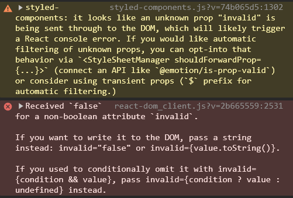

So for props used only for styling it is common convention to prefix prop names with a `$` sign.

```JSX
<Label $invalid={emailNotValid}>Email</Label>
```

This is still a valid prop name allowed in JS, but it won't clash with built-in props.

To handle nested rules and media queries, instead of rules written in plain CSS:

```css
header {
  display: flex;
  flex-direction: column;
  align-items: center;
  justify-content: center;
  margin-top: 2rem;
  margin-bottom: 2rem;
}

header img {
  object-fit: contain;
  margin-bottom: 2rem;
  width: 11rem;
  height: 11rem;
}

header h1 {
  font-size: 1.5rem;
  font-weight: 600;
  letter-spacing: 0.4em;
  text-align: center;
  text-transform: uppercase;
  color: #9a3412;
  font-family: "Pacifico", cursive;
  margin: 0;
}

header p {
  text-align: center;
  color: #a39191;
  margin: 0;
}

@media (min-width: 768px) {
  header {
    margin-bottom: 4rem;
  }

  header h1 {
    font-size: 2.25rem;
  }
}
```

It can be done in styled component like this:

```jsx
import { styled } from "styled-components";

const StyledHeader = styled.header`
  display: flex;
  flex-direction: column;
  align-items: center;
  justify-content: center;
  margin-top: 2rem;
  margin-bottom: 2rem;

  & img {
    object-fit: contain;
    margin-bottom: 2rem;
    width: 11rem;
    height: 11rem;
  }

  & h1 {
    font-size: 1.5rem;
    font-weight: 600;
    letter-spacing: 0.4em;
    text-align: center;
    text-transform: uppercase;
    color: #9a3412;
    font-family: "Pacifico", cursive;
    margin: 0;
  }

  & p {
    text-align: center;
    color: #a39191;
    margin: 0;
  }

  @media (min-width: 768px) {
    margin-bottom: 4rem;

    & h1 {
      font-size: 2.25rem;
    }
  }
`;
```

Where `&` sign means _this_ component (so the header in this case).

For pseudoselectors it is similar. So instead of this:

```css
.button {
  padding: 1rem 2rem;
  font-weight: 600;
  text-transform: uppercase;
  border-radius: 0.25rem;
  color: #1f2937;
  background-color: #f0b322;
  border-radius: 6px;
  border: none;
}

.button:hover {
  background-color: #f0920e;
}
```

It can be done in styled component like this:

```jsx
import { styled } from "styled-components";

const Button = styled.button`
  padding: 1rem 2rem;
  font-weight: 600;
  text-transform: uppercase;
  border-radius: 0.25rem;
  color: #1f2937;
  background-color: #f0b322;
  border-radius: 6px;
  border: none;

  &:hover {
    background-color: #f0920e;
  }
`;
```

To reuse styled-components you can move them into separate file. So e.g. `Button.jsx` could look like this:

```jsx
import { styled } from "styled-components";

const Button = styled.button`
  padding: 1rem 2rem;
  font-weight: 600;
  text-transform: uppercase;
  border-radius: 0.25rem;
  color: #1f2937;
  background-color: #f0b322;
  border-radius: 6px;
  border: none;

  &:hover {
    background-color: #f0920e;
  }
`;

export default Button;
```

and then just simply import whenever you need this component:

```jsx
import Button from "./Button.jsx";
```

### 5.4.1. Pros

- **No extensive CSS knowledge required** - You don't need to know a lot about CSS
- **Rapid development** - Quickly build and style components
- **No style clashes** - Utilities avoid custom CSS rule conflicts
- **Highly configurable** - Easily customized and extended through the theme

### 5.4.2. Cons

- **Long `className` values** - Relatively long `className` values
- **JSX & styling coupled** - Any style changes require editing JSX
- **Wrapper components** - You end up with many relatively small "wrapper components" OR lots of copy and pasting the same style

## 5.5. Tailwind CSS

CSS framework that can be used in any web project. It is not focused on React but it works really well with React. TailWind is all about adding tiny utility CSS classes to HTML elements to apply styles step by step. In addition Tailwind also sets up some base styles that will affect the overall document.

When you see it for the first time it can look quite intimidating and ugly. After all you are going to add a lot of css classes into your JSX code.

Actually it is pretty convienient because you don't need to know CSS in order to use it. That's the idea behind this framework.

Here's [installation guide](https://tailwindcss.com/docs/installation/using-vite) for different build tools. You should go through those setup steps.

These steps myay change over time, but generally it involves these steps:

For an existing project you should run this command to install package:

```shell
npm install tailwindcss @tailwindcss/vite
```

Add the @tailwindcss/vite plugin to Vite configuration

```jsx
import { defineConfig } from "vite";
import tailwindcss from "@tailwindcss/vite";

export default defineConfig({
  plugins: [tailwindcss()],
});
```

Install **Tailwind CSS IntelliSense** in VSCode

### 5.5.1. Adding custom font

In index.css import this:

```
@theme {
  --font-title: "Pacifico", cursive;
}
```

And use class `font-title` in text you want to update

```jsx
import logo from "../assets/logo.png";

export default function Header() {
  return (
    <header className="flex flex-col items-center mt-8 mb-16">
      
      <h1 className="text-4xl font-semibold tracking-widest text-center uppercase text-amber-800 font-title">
        ReactArt
      </h1>
      <p className="text-stone-500">A community of artists and art-lovers.</p>
    </header>
  );
}
```

### 5.5.2. Media queries and pseudo selectors

Tailwind support responsive design, for example to the width of the browser window. It has built-in prefixes to use.

Tailwind uses a mobile-first breakpoint system, similar to what you might be used to in other frameworks like Bootstrap.

What this means is that unprefixed utilities (like uppercase) take effect on all screen sizes, while prefixed utilities (like md:uppercase) only take effect at the specified breakpoint and above.

Tailwind CSS breakpoints:

| Breakpoint prefix |  Minimum width | CSS                               |
| ----------------- | -------------: | --------------------------------- |
| **`sm`**          |  40rem (640px) | `@media (width >= 40rem) { ... }` |
| **`md`**          |  48rem (768px) | `@media (width >= 48rem) { ... }` |
| **`lg`**          | 64rem (1024px) | `@media (width >= 64rem) { ... }` |
| **`xl`**          | 80rem (1280px) | `@media (width >= 80rem) { ... }` |
| **`2xl`**         | 96rem (1536px) | `@media (width >= 96rem) { ... }` |

Then when specyfying a class for an element you can prefix it and use colon to declare such media query. For example, if you want a smaller margin bottom all of the devices to medium you could write something like this:

```jsx
export default function Header() {
  return (
    <header className="flex flex-col items-center mt-8 md-8 md:mb-16"></header>
  );
}
```

Same will work with `hover:` and `focus:` for example.

### 5.5.3. Pros

- You don't need to know (a lot about) CSS
- Rapid development
- No style clashes between components since you don't define any CSS rules
- highly configurable and extensible

### 5.5.4. Cons

- Relatively long className values
- any style changes require editing JSX
- you end up with many relatively small "wrapper components" OR lots of copy and pasting

# 6. Debugging React apps

## 6.1. React strict mode

Using strict mode typically begins in `index.jsx`, though you can enable it just for parts of your application. Strict mode in the end is simply a component you import from react.

```jsx
import { StrictMode } from "react";
```

It is a component provided by React that's meant to be wrapped around other components, for example around the `App` component

```jsx
ReactDOM.createRoot(document.getElementById("root")).render(
  <StrictMode>
    <App />
  </StrictMode>,
);
```

`StrictMode` does a couple of things behind the scenes that can help us catch certain problems in our app. For example, one of the most inportant thing `StrictMode` component does, is that it will execute every component function twice instead of just once (it only does that in development). Thanks to that it might be more obvious when something isn't properly cleared, like assigning empty array to const outside of component function (so it does not get cleared the second time component is rendered).

```jsx
// example of silent error that's easier to debug with StrictMode
import { calculateInvestmentResults, formatter } from "../util/investment.js";

const results = []; // results outside of component function get's called only once

export default function Results({ input }) {
  // const results = []; <--- emptying results should happen here
  calculateInvestmentResults(input, results);
  const initialInvestment =
    results[0].valueEndOfYear -
    results[0].interest -
    results[0].annualInvestment;

  return (
    <table id="result">
      <thead>
        <tr>
          <th>Year</th>
          <th>Investment Value</th>
          <th>Interest (Year)</th>
          <th>Total Interest</th>
          <th>Invested Capital</th>
        </tr>
      </thead>
      <tbody>
        {results.map((yearData) => {
          const totalInterest =
            yearData.valueEndOfYear -
            yearData.annualInvestment * yearData.year -
            initialInvestment;
          const totalAmountInvested = yearData.valueEndOfYear - totalInterest;

          return (
            <tr key={yearData.year}>
              <td>{yearData.year}</td>
              <td>{formatter.format(yearData.valueEndOfYear)}</td>
              <td>{formatter.format(yearData.interest)}</td>
              <td>{formatter.format(totalInterest)}</td>
              <td>{formatter.format(totalAmountInvested)}</td>
            </tr>
          );
        })}
      </tbody>
    </table>
  );
}
```

Thanks to strict mode now bug is more visible as result is displayed twice as results is properly cleared:

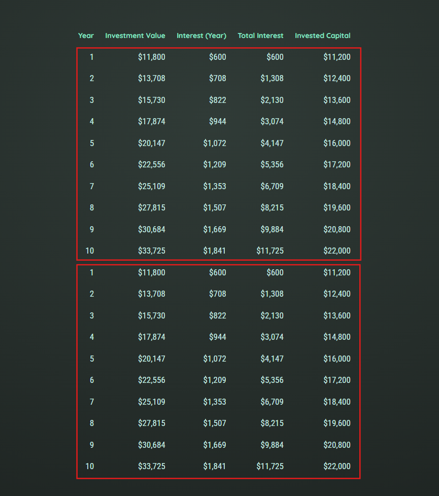

# 7. Refs and portals

Advanced DOM access and value management

- Accessing **DOM Elements** with **Refs**
- **Managing Values** with Refs (that shouldn't be state)
- **Exposing API Functions** from Components
- **Detaching DOM Rendering** from JSX Structure with **Portals**

## 7.1. Refs

**Example task**:
Create a Player component that read the value that is entered into input field at the point of time where button is pressed.

With current knowledge we would lean to two-way binding which looks like this:

```jsx
import { useState } from "react";

export default function Player() {
  const [enteredPlayerName, setEnteredPlayerName] = useState("");
  const [submitted, setSubmitted] = useState(false);

  function handleChange(event) {
    setSubmitted(false);
    setEnteredPlayerName(event.target.value);
  }

  function handleClick() {
    setSubmitted(true);
  }

  return (
    <section id="player">
      <h2>Welcome {submitted ? enteredPlayerName : "unknown entity"}</h2>
      <p>
        <input type="text" onChange={handleChange} value={enteredPlayerName} />
        <button onClick={handleClick}>Set Name</button>
      </p>
    </section>
  );
}
```

Using old way of two-way binding seems like a lot of work for simple task, as we need to manage entered value (`enteredPlayerName` state) with every key stroke (`onChange` prop) and we need second state just to know whether button was pressed or not.

---

**We can simplify this by using ref.**

Ref in React is a value, just as state or variable, but it is special kind of value - managed in React in a special way.

To create such a ref value you need to import `useRef` hook.

```jsx
import { useRef } from "react";
```

This is yet another hook function which, like all hook functions, must be called inside of a component function (or inside of a custom hook - explained later in the course).

Then you create ref value like this and can store it in a constant or variable with any name you want.

```jsx
const playerName = useRef();
```

One thing you can do with refs, and probably the thing you will be doing the most with them, is to connect them to jsx elements. And you can do that with the special prop that's supported by all React components automatically out of the box. The `ref` prop.

```jsx
<input
  ref={playerName}
  type="text"
  onChange={handleChange}
  value={enteredPlayerName}
/>
```

`ref` prop takes ref value as an input.

In example this input component is in the end connected to this ref.

How does that connection help us?

Well, we can now use this ref value for example in `handleClick` to access the underlying connected element.

So through `playerName` we can access input element because playerName is connected to it through the ref prop.

So for example in the `handleClick` function we can access the input element, though it's worth noting that for all these ref values created with `useRef` you first have to access the `current` property. So this ref value you are getting back from `useRef` will always be a js object that will always have a current property (and only this property) and it is in this current property that the actual ref value will be stored (in this case input element).

And therefore using this ref we can use all the methods and properties that are exposed by that input HTML element. And it really is native HTML element, to learn what method and properties are exposed by it you can visit [mdn docs](https://developer.mozilla.org/en-US/docs/Web/HTML/Reference/Elements/input).

For input one of the properties is value. So we can access this property to set player name on button click.

```jsx
function handleClick() {
  setEnteredPlayerName(playerName.current.value);
}
```

So final Player component using refs will look like this:

```jsx
import { useRef, useState } from "react";

export default function Player() {
  const playerName = useRef();
  const [enteredPlayerName, setEnteredPlayerName] = useState(null);

  function handleClick() {
    setEnteredPlayerName(playerName.current.value);
  }

  return (
    <section id="player">
      <h2>Welcome {enteredPlayerName ?? "unknown entity"}</h2>
      <p>
        <input ref={playerName} type="text" />
        <button onClick={handleClick}>Set Name</button>
      </p>
    </section>
  );
}
```

Thanks to this we don't need to log that value on every keystroke anymore. So no need for `handleChange` function. No need for `submitted` state. And just keep `playerName` ref and `enteredPlayerName` state.

in the input component also there is no need for `onChange` and `value` props anymore.

Ref feature exists for use cases like this, where you just want to read a value from an input field for example. It can help save a lot of code and lead to leaner components.

# 8. React behind the scenes - optimization techniques

## 8.1. How does React update the DOM?

It updates from top to bottom of the tree. The App component is usally the top component. If any custom component is in renderable JSX part of it then it will render (execute component function) of this component as well and so on.

## 8.2. Optimization

### 8.2.1. `React.memo()`

To prevent unnecessary renders triggered by a parent component you can use `memo` function. Just wrap your component function as argument to memo function imported from React. To work in all cases Sonar would advise that instead of exporting directly this memo it is better to store it as a const (preferably with the same name as the component) first and then export this const.

This `memo` function prevents triggering component function if props are the same. It does not care about internal state though and will not prevent rerendering if state changes (`useState`).

**Don't overuse `memo()`**.

It might be tempting to wrap all your component functions in memo. But you should **NOT** do that. Checking props with `memo()` costs performance. If you wrap it around all your components it will add a lot of unnecessary checks.

Instead, **use it as high up in the component tree as possible**. Blocking a component execution there also block all child component executions.

### 8.2.2. Avoid component function executions with clever structuring

State changes and reexecutions of child components do **NOT** trigger parent component executions. Knowing that, moving state as low in the tree as possible is preferred.

### 8.2.3. `useCallback()` hook

In general, `useCallback` is a wrapper around an existing function. It is primarily used together with `React.memo`.

A common example is when you pass an `onClick` handler from a parent component to a child component. Even if the function's code stays the same, a new function is created every time the parent component re-renders. Because of that, `React.memo` treats it as a different prop and re-renders the child component.

To avoid this, we can let React manage the function's lifecycle by wrapping it in `useCallback()`. The hook returns a memoized version of the function, and it is common to store it in a `const` with the same name as the original function.

`useCallback` takes two arguments:

1. The function to memoize.
2. An array of dependencies.

As long as none of the dependencies change, `useCallback` returns the same function instance on every render. This allows `React.memo` to see that the prop has not changed and avoid unnecessary re-renders.

### 8.2.4. `React.useMemo()`

Just as you want to prevent component functions with `memo`, you also may want to prevent execution of normal functions that are called inside component functions, unless their import changed. React gives us `useMemo` hook.

- `memo` - wrapped around component functions
- `useMemo` - wrapped around normal functions inside component funcitons

`useMemo` takes two arguments:

1. A function that returns the value you want to memoize.
2. An array of dependencies.

```jsx
const sortedUsers = useMemo(() => {
  return users.sort((a, b) => a.name.localeCompare(b.name));
}, [users]);
```

In the example above, the sorting operation will only run again when `users` changes. On every other render, React returns the previously computed value.

This can be useful when:

- Performing expensive calculations.
- Filtering or sorting large arrays.
- Creating derived data from props or state.
- Returning objects or arrays that are passed to memoized child components.

For example:

```jsx
const filteredUsers = useMemo(() => {
  return users.filter((user) => user.active);
}, [users]);
```

Without `useMemo`, the filter operation would run on every render, even if `users` had not changed.

However, `useMemo` should **NOT** be used everywhere. Memoization also has a cost because React needs to store the previous value and compare dependencies on every render. For cheap calculations, `useMemo` can actually make your code more complicated without providing any performance benefit.
